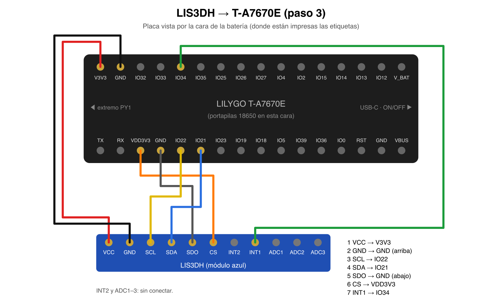
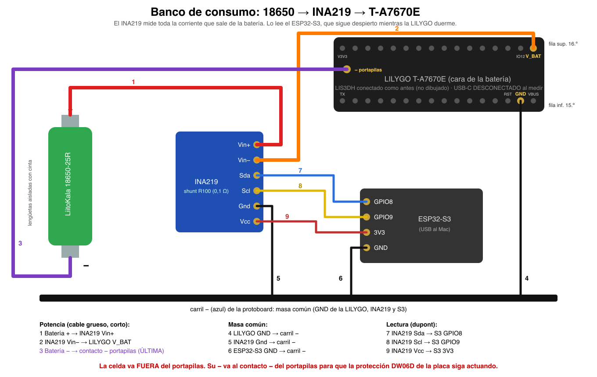

# Guardian firmware (Rust)

Firmware de la **LILYGO T-A7670E (ESP32 + SIMCom A7670E)** en Rust, sobre
ESP-IDF v5.4.2 (`esp-idf-svc`). La pieza actual es la herramienta de banco
**bring-up**, que cubre los pasos 1–4 de
[COMPONENTES.md](../docs/COMPONENTES.md#primera-secuencia-al-recibir-las-piezas)
y la medida P1. El **banco de consumo** (`power-bench`, un ESP32-S3 que lee un
INA219) mide P1–P5. El firmware de producción reutilizará `guardian-core` y
`guardian-drivers`.

## Por qué Rust y dónde

| Capa | Lenguaje | Motivo |
|---|---|---|
| Lógica (dominio, casos de uso, protocolo futuro) | Rust `no_std`, sin `unsafe` | Seguridad de memoria y tipos donde viven los secretos y el protocolo v2. Tests con `cargo test` en el Mac. |
| Drivers (LIS3DH, framing AT) | Rust `no_std` sobre `embedded-hal` 1.0 | Independientes de la HAL. Se testean con mocks de I²C/GPIO. |
| Adapters de placa | Rust `std` sobre `esp-idf-hal` | Drivers ESP-IDF probados (UART, I²C, ADC calibrado, deep sleep). El `unsafe` queda confinado a `hold.rs`, `platform.rs`, `wiring.rs` y `modem/transport.rs`, con `SAFETY` documentado. |
| Sistema (RTOS, drivers, sleep) | C de ESP-IDF | Lo da Espressif. No se reescribe. |

## Arquitectura (hexagonal)

```text
 guardian-core (no_std, forbid(unsafe))
 ├── accel.rs     Accel, Threshold (newtype: solo existe ya acotado)
 ├── command.rs   parser de consola, pureza total
 ├── power.rs     PowerWindow: media ponderada por tiempo, extremos, carga (µAh)
 ├── ports.rs     traits: Modem · MotionSensor · Platform · PowerMeter   (salida = fmt::Write)
 └── bringup/     casos de uso: identify, gnss, selftest, watch, sleep_until_motion
          ▲ implementan
 guardian-drivers (no_std, embedded-hal 1.0)
 ├── lis3dh.rs    Lis3dh<I2c, InputPin, DelayNs>: MotionSensor
 ├── ina219.rs    Ina219<I2c>: PowerMeter (shunt crudo, sin registro de calibración)
 └── at.rs        LineFramer + final_result (lado puro del módem)
          ▲ usan
 bringup (xtensa-esp32-espidf, std)
 ├── board.rs     ÚNICO sitio con pines físicos → roles
 ├── modem/       A7670: potencia + AtTransport (hilo lector, Condvar)
 ├── platform.rs  identidad, ADC batería, ext0 wake, deep sleep
 ├── hold.rs      hold de pads en deep sleep
 ├── wiring.rs    niveles SDA/SCL antes del I²C: ¿llega cada cable?
 ├── console.rs   consola UART0 + Stdout: fmt::Write
 └── main.rs      composition root: cablea y entra en el bucle
 power-bench (xtensa-esp32s3-espidf, std)
 ├── link.rs      puente USB ⇄ consola de la LILYGO (UART1, GPIO17/18), comandos `~`
 └── main.rs      composition root: I²C GPIO8/9 → Ina219 → PowerWindow → USB
```

Reglas:
- `guardian-core` no depende de nada.
- `guardian-drivers` depende solo del core y de `embedded-hal`.
- Solo `bringup` y `power-bench` conocen ESP-IDF.
- Ningún archivo pasa de 300 líneas. `missing_docs = "deny"` y clippy `pedantic` en todos los crates.

## Tests (sin placa)

```bash
make test-firmware          # core (44) + drivers (25)
```

Los drivers verifican el tráfico I²C exacto: la receta de interrupción AN3308,
el decodificado de 12 bits, el fallback de dirección 0x18→0x19 y que rechaza un
LIS3DSH.

CI:
- `firmware-host`: fmt, clippy y test de core y drivers.
- `firmware-esp32`: clippy y build de `bringup` (`xtensa-esp32-espidf`) y
  `power-bench` (`xtensa-esp32s3-espidf`).

## Toolchain (una vez)

```bash
cargo install espup ldproxy espflash --locked
espup install --targets esp32,esp32s3   # Rust fork para Xtensa → ~/export-esp.sh
```

`esp-idf-sys` descarga y compila ESP-IDF v5.4.2 (fijado en
`bringup/.cargo/config.toml`). Las herramientas se comparten en `~/.espressif`.

## Compilar, flashear, monitor

```bash
. ~/export-esp.sh
cd firmware/bringup
cargo build --release
cargo run --release            # = espflash flash --monitor (elige el puerto)
```

El puerto aparece como `/dev/cu.wchusbserial*` o `/dev/cu.usbserial*`. Si no
aparece, el cable USB-C es solo de carga.

## Cableado LIS3DH



Pines leídos de la serigrafía de la unidad 1 (cara de la batería):
[fila superior](../docs/hardware/img/t-a7670e-header-top.jpg),
[fila inferior](../docs/hardware/img/t-a7670e-header-bottom.jpg).
La placa viene **sin pines soldados**: hay que soldar las tiras antes de cablear.

| LIS3DH | LILYGO |
|---|---|
| VCC | 3V3 |
| GND | GND |
| SCL | IO22 |
| SDA | IO21 |
| CS | 3V3 (fuerza I²C) |
| SDO | GND (dirección 0x18) |
| INT1 | IO34 (+ 100 kΩ a GND, recomendado) |
| INT2, ADC1–3 | sin conectar |

**Pull-down recomendado.** INT1 del LIS3DH es push-pull: con el sensor
alimentado, la línea siempre tiene nivel y el banco funciona sin resistencia. IO34
no tiene pulls internos y el wake ext0 es por nivel alto. Si INT1 se suelta o el
sensor pierde alimentación, la línea flota: la placa despierta en bucle o
`!sleep` se niega a dormir. En el dispositivo final es obligatorio (vibración).

## Comandos (monitor serie)

| Comando | Paso | Qué valida |
|---|---|---|
| `!diag` | 1–2 | chip, PSRAM, MAC, VBAT, `ATI`, `AT+SIMCOMATI`, SIM, `CSQ`, registro LTE |
| `!gnss` → `AT+CGNSSINFO` | 2 | GNSS (antena al exterior; repetir hasta fix) |
| `!lis` | 3 | detección + 10 muestras; PASS si todas ≈ 1 g (±150 mg). Si no lo encuentra, barre el bus I²C |
| (arranque) | 3 | niveles SDA/SCL con pull-down: dice qué cable no llega al módulo |
| `!arm [mg]` | 4a | INT1 durante 30 s con la placa despierta |
| `!sleep [mg]` | 4b / P1 | módem OFF, deep sleep, despertar por movimiento |
| `!standby [mg]` | P2 | módem registrado en su sleep LTE (`AT+CSCLK=1`, DTR alto retenido), deep sleep, despertar por movimiento. Registrar antes (`!diag`) |
| `!vbat` | — | rail de batería |
| `!modem on\|off` | — | secuencia de potencia del módem |
| `AT...` | — | cualquier línea sin `!` va tal cual al módem |

Umbral por defecto 80 mg, rango 16–2032 mg (pasos de 16 mg a ±2 g).

## Banco de consumo (P1–P5)



Un ESP32-S3 aparte lee un INA219 en serie con la batería de la LILYGO. Sigue
midiendo mientras la LILYGO duerme.

- **La celda va fuera del portapilas.** Su − va al contacto − del portapilas,
  no a GND: la protección DW06D de la placa está entre los dos y debe seguir en
  el circuito (y su consumo cuenta en P1).
- **USB-C de la LILYGO desconectado** al medir: si no, se alimenta por USB.
- Rango ±3,2 A, resolución 0,1 mA (shunt 0,1 Ω). Para P1 (µA), contrastar con
  el multímetro en serie.

```bash
. ~/export-esp.sh
cd firmware/power-bench
cargo run --release            # puerto /dev/cu.usbmodem* (USB nativo del S3)
```

Una línea por segundo:

```text
t=   12s  I    45.31 mA  min    44.90  max   120.00  V 3.781 V  avg    46.02 mA  Q 0.152 mAh
```

`I`/`min`/`max`: último segundo. `avg` y `Q`: desde el arranque del S3 o el
último `~reset`. `V`: tensión que llega a la LILYGO.

**Consola de la LILYGO a través del S3** (cables 10 y 11): con su USB
desconectado, las líneas escritas al S3 van a la LILYGO (`!sleep`, `!modem on`,
…) y su salida vuelve con el prefijo `| `, intercalada con las lecturas. Las
líneas que empiezan por `~` son del banco: `~reset` reinicia `avg`/`Q` para
medir la carga de un evento, `~help` las lista.

**Cables de potencia (1, 2, 3) gruesos, cortos y soldados.** El LTE pide picos
de ~2 A: con 0,6 Ω de dupont y protoboard (medido en la unidad 1) caen más de
1 V y la placa se reinicia o la protección corta la batería.

## Supuestos a verificar en banco

- **Pines**: tomados de `LILYGO_T_A7670` en el `utilities.h` oficial (`bringup/src/board.rs`).
- **Divisor VBAT ×2** (`BATTERY_DIVIDER_X1000`): hay que medir R7/R9.
- **PWRKEY**: el pulso de encendido (100 ms) no puede apagar un A7670 encendido,
  porque apagarlo requiere pulsación larga (LILYGO: 3000 ms). **Confirmar en banco.**
  La pulsación larga solo se usa si el módem responde a `AT` tras fallar `AT+CPOF`.
- **Módem mudo = corte de alimentación**: si no responde a `AT`, `power_off` abre
  `POWER_EN` sin `CPOF`.
- **Deep sleep**: `POWER_EN`, `PWRKEY`, `RESET` (inactivo), `DTR` y `TX` quedan
  retenidos en bajo, para que P1 se mida sin alimentar el módem por las líneas de señal.
- **`!sleep` se niega** a dormir si INT1 sigue alto tras limpiar el latch, si no se
  puede leer el latch o si falla el hold de algún pin.
- **Correlación AT**: el protocolo no tiene ids. `ResultGate` (en `guardian-drivers`,
  testeado en host) cuenta los resultados que se deben a comandos con timeout o
  a líneas de passthrough, y descarta esos antes de aceptar uno. Un comando nuevo
  espera a que no se deba nada, máximo 2 s.
- **Niveles al arrancar**: primero `PWRKEY` en reposo, `RESET` inactivo y `DTR`
  bajo; al final `POWER_EN` alto, para no cortar un módem que siguió vivo tras un
  reset del ESP32. Efecto: tras un arranque en frío o un wake, el rail del módem
  queda energizado (módem apagado) hasta `!modem off` o `!sleep`. **Al medir
  consumo despierto, ejecutar `!modem off` antes.**
- **Imprecisión conocida del gate AT**: un `ERROR` no solicitado mientras se
  deben resultados cuenta como uno de ellos. SIMCom no emite códigos finales
  sueltos en operación normal.
- **Arranque tras deep sleep**: `Board::take` libera los holds de los pads del
  módem antes de que ningún driver los toque. Un pad retenido ignora las
  escrituras y no se puede re-muxear.
- **Aparcado todo o nada**: si falla el hold de un pin, se deshace (holds
  liberados y TX devuelto a la UART) y el módem sigue usable sin reiniciar.
- **Passthrough `AT+CPOF`/`AT+CPOWD`** ejecuta la secuencia completa de apagado.
- **INT1 sin duración** (`INT1_DURATION = 0`): una sola muestra sobre el umbral
  despierta. Es la máxima sensibilidad para banco; el filtrado se ajusta en el vehículo.
- **Consola**: Ctrl-Z y ESC no llegan al módem (SMS en modo texto fuera de alcance).
